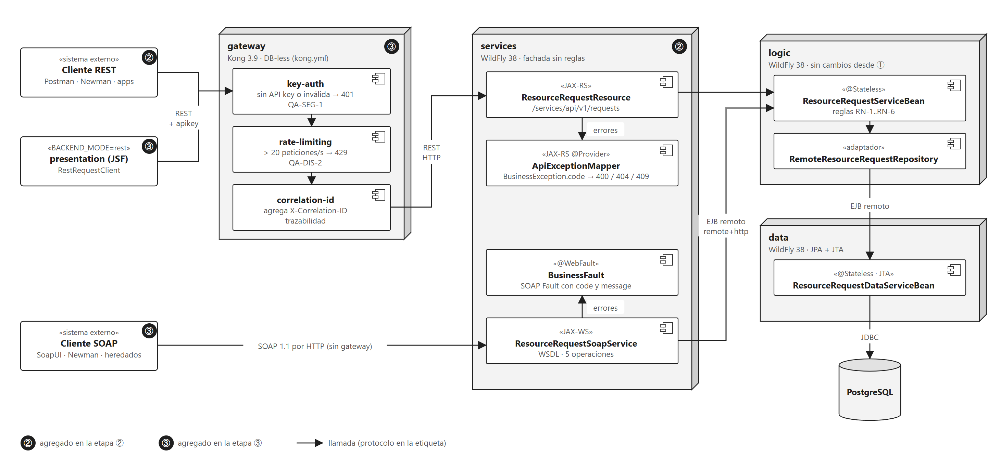

# Taller 4 Jakarta EE: Presentación, capas distribuidas y servicios

**Pontificia Universidad Javeriana · Arquitectura de Software · Taller No. 4 Jakarta Enterprise Edition (Presentación)**

Sistema de **solicitudes de recursos en emergencias** (dominio del Taller 2) desplegado en capas separadas. El taller
pide tres esquemas y se implementan como **tres etapas del mismo sistema**:

| Etapa | Camino | Qué agrega |
|---|---|---|
| ① | JSF (Tomcat) → Lógica (WildFly) → Datos (WildFly) → PostgreSQL | Presentación y capas en servidores distintos, unidas por EJB remoto |
| ② | Cliente REST o SOAP → Servicios (WildFly) → Lógica | Una fachada de servicios para clientes que no son Java |
| ③ | Cliente → API Gateway (Kong) → Servicios REST; SOAP directo a Servicios | Seguridad, límite de demanda y trazabilidad en un solo punto |

La pantalla JSF cambia de la etapa ① a la ③ solo con la variable `BACKEND_MODE=ejb|rest`, sin recompilar.

> Estado: sistema completo. Las 89 pruebas unitarias y los seis escenarios de calidad pasan; resultados en
> `docs/arquitectura.md` §12.

---

## Contenido

1. [Entregables](#1-entregables)
2. [Inicio rápido](#2-inicio-rápido)
3. [Requisitos](#3-requisitos)
4. [Ejecución con Docker](#4-ejecución-con-docker)
5. [Cómo probar el sistema](#5-cómo-probar-el-sistema)
6. [Arquitectura](#6-arquitectura)
7. [Requisitos del taller y su implementación](#7-requisitos-del-taller-y-su-implementación)
8. [Reglas de negocio y errores](#8-reglas-de-negocio-y-errores)
9. [Configuración](#9-configuración)
10. [Decisiones de diseño y alcance](#10-decisiones-de-diseño-y-alcance)
11. [Solución de problemas](#11-solución-de-problemas)
12. [Distribución del trabajo](#12-distribución-del-trabajo)

---

## 1. Entregables

| Entregable | Ubicación |
|---|---|
| Código fuente (Maven multimódulo) | `contracts/`, `data/`, `logic/`, `services/`, `presentation-jsf/`, `pom.xml` |
| **Diseño arquitectónico** (vistas 4+1, escenarios de calidad, decisiones, riesgos, trazabilidad) | `docs/arquitectura.md` |
| Diagramas (10 figuras, SVG y PNG, con su fuente) | `docs/diagramas/` |
| Contratos: EJB, REST, SOAP/WSDL, gateway | `docs/api.md` |
| Despliegue reproducible | `docker-compose.yml`, `infra/` |
| Pruebas de API (Newman) | `tests/postman/` |
| Scripts de los escenarios de calidad | `scripts/` |
| Evidencias de ejecución | `docs/evidencias/` |
| Paquete de entrega | `Taller4_Entrega.zip`, generado con `python scripts/empaquetar.py` |

---

## 2. Inicio rápido

Con Docker Desktop abierto, desde la carpeta del proyecto:

```bash
docker compose up -d --build --wait
```

El primer build tarda varios minutos: descarga WildFly, Tomcat, Kong y PostgreSQL, y compila los módulos con Maven
dentro de Docker. `--wait` termina cuando los seis contenedores están sanos. Después:

| Qué | Dirección |
|---|---|
| Pantalla JSF | `http://localhost:8080/recursos/` |
| API REST por el gateway | `http://localhost:8000/api/v1/requests` con el header `apikey: clave-taller4` |
| WSDL del servicio SOAP | `http://localhost:8082/services/ResourceRequestSoapService?wsdl` |

Para pasar la pantalla JSF de la etapa ① (EJB) a la ③ (REST por el gateway):

```bash
BACKEND_MODE=rest docker compose up -d --no-build presentation
```

---

## 3. Requisitos

| Para | Necesitas |
|---|---|
| Ejecutar el sistema | Docker Desktop con Docker Compose v2 y unos 6 GB libres en disco |
| Correr los scripts de `scripts/` | Bash (Git Bash en Windows) y `curl` |
| Compilar y correr las pruebas unitarias fuera de Docker (opcional) | JDK 17 o superior y Maven 3.9 |
| Regenerar las colecciones de Newman (opcional) | Python 3 |
| Regenerar los diagramas (opcional) | Python 3 y Node.js con `@mermaid-js/mermaid-cli` (ver `docs/diagramas/README.md`) |

No hace falta instalar WildFly, Tomcat, Kong, PostgreSQL ni Newman: todos corren en contenedores.

---

## 4. Ejecución con Docker

### Servicios

`docker-compose.yml` levanta seis contenedores, uno por nodo de la vista física:

| Servicio | Imagen | Puerto en el equipo | Papel |
|---|---|---|---|
| `postgres` | `postgres:16-alpine`, volumen `postgres_data` | `5434` | Base de datos |
| `data` | WildFly 38 con `data.war` | — (solo red interna) | Capa de Datos: JPA y JTA, EJB `@Remote` |
| `logic` | WildFly 38 con `logic.war` | — (solo red interna) | Capa de Lógica: reglas de negocio, EJB `@Remote` |
| `services` | WildFly 38 con `services.war` | `8082` | Fachada REST (JAX-RS) y SOAP (JAX-WS) |
| `gateway` | `kong:3.9.4` sin base de datos | `8000` | API Gateway: API key, límite de peticiones, id de correlación |
| `presentation` | Tomcat 10.1 con `recursos.war` | `8080` | Presentación JSF (Faces 4 y Weld) |

Las imágenes se construyen en dos etapas: Maven compila el módulo dentro de Docker y la segunda etapa copia el WAR al
servidor. Los WildFly se configuran con scripts CLI de `infra/wildfly/`. Cada contenedor tiene un healthcheck y
arranca cuando sus dependencias están sanas.

### Comandos

```bash
docker compose up -d --build --wait     # construir y levantar todo
docker compose ps                       # estado de los contenedores
docker compose logs -f logic            # log de una capa
docker compose stop data                # detener una capa (para probar disponibilidad)
docker compose down                     # detener todo (conserva los datos)
docker compose down -v                  # detener y BORRAR los datos de PostgreSQL
```

### Credenciales por defecto

| Uso | Valor | Variable para cambiarlo |
|---|---|---|
| Usuario de aplicación de WildFly para las llamadas EJB | `ejbuser` / `Ejb.Pass2026` | `EJB_USER`, `EJB_PASSWORD` |
| API key del gateway | `clave-taller4` | `API_KEY` (y `infra/kong/kong.yml`) |
| PostgreSQL | `recursos` / `recursos`, base `recursos` | `DB_USER`, `DB_PASSWORD` |

Son valores de taller (riesgo R-6 en `docs/arquitectura.md`); se sobrescriben con variables de entorno o un `.env`.

---

## 5. Cómo probar el sistema

### 5.1 Pruebas de API con Newman

Las colecciones están en `tests/postman/` y Newman corre en un contenedor dentro de la red de Compose:

```bash
docker run --rm --network jee-presentacion_default -v "$PWD/tests/postman:/etc/newman" \
  postman/newman:6-alpine run rest.postman_collection.json -e gateway.postman_environment.json
```

| Colección | Qué prueba | Peticiones |
|---|---|---|
| `rest.postman_collection.json` | RF-1..RF-5 y todas las reglas de error por REST (entorno `gateway` o `directo`) | 14 |
| `soap.postman_collection.json` | WSDL, RF-1..RF-5 y SOAP Faults | 12 |
| `gateway.postman_collection.json` | QA-SEG-1: 401 sin clave o con clave inválida, id de correlación y límite | 3 |

`local.postman_environment.json` sirve para abrir las colecciones en Postman desde el equipo.

### 5.2 Escenarios de calidad

Cada script imprime el resultado (`CUMPLE` o `NO CUMPLE`) y guarda la salida en `docs/evidencias/qa/`:

| Script | Escenario | Qué mide |
|---|---|---|
| `scripts/qa-int-1.sh` | QA-INT-1 Interoperabilidad | Newman REST (vía Kong y directo) y SOAP: 100 % de aserciones en verde |
| `scripts/qa-seg-1.sh` | QA-SEG-1 Seguridad | Sin API key la petición se rechaza en Kong y no llega a `services` |
| `scripts/qa-dis-2.sh` | QA-DIS-2 Picos de demanda | Una ráfaga de 50 peticiones recibe 429 por encima de 20 por segundo |
| `scripts/qa-dis-1.sh` | QA-DIS-1 Disponibilidad | Con `data` caído, error controlado en ≤ 5 s; recuperación sin reiniciar las otras capas |
| `scripts/qa-mod-1.sh` | QA-MOD-1 Modificabilidad | La pantalla pasa de EJB a REST solo con `BACKEND_MODE`, con la misma imagen |
| `scripts/medir-latencia.sh` | QA-REN-1 Rendimiento | p50 y p95 de cada camino (①, ② y ③) |
| `scripts/rn-5-concurrencia.sh` | RN-5 con concurrencia | 10 atenciones simultáneas: una gana y las demás reciben 409 |

Resultados vigentes en `docs/arquitectura.md` §12: todos los escenarios cumplen.

### 5.3 Recorrido manual

**Por la pantalla JSF** (`http://localhost:8080/recursos/`): registrar una solicitud, verla en la tabla como
`PENDIENTE`, atenderla y ver que sale de las pendientes. Con cantidad 0 aparece el mensaje de negocio de la Lógica.

**Por REST** (vía gateway):

```bash
curl -s -X POST http://localhost:8000/api/v1/requests -H 'apikey: clave-taller4' -H 'Content-Type: application/json' \
  -d '{"disasterDescription":"Inundación en Mocoa","resourceType":"Agua potable","quantity":120,"priority":"ALTA"}'
curl -s -X PUT http://localhost:8000/api/v1/requests/1/attend -H 'apikey: clave-taller4'   # 200; la segunda vez 409
curl -s http://localhost:8000/api/v1/requests/pending -H 'apikey: clave-taller4'
```

**Por SOAP**: importar el WSDL en SoapUI o Postman, o enviar el sobre de ejemplo de `docs/api.md` §4.

### 5.4 Pruebas unitarias

```bash
mvn clean test
```

Cubren la serialización de los contratos, la política de conexión EJB (`RemoteEjbLocator`), la capa de Datos
(incluido el bloqueo optimista y el precalentamiento) y las reglas de negocio de la Lógica.

---

## 6. Arquitectura



**Estilo:** N capas distribuidas. Cada capa corre en su propio servidor y solo conoce la interfaz remota de la
siguiente. Las reglas de negocio viven **solo en la Lógica**: JSF, REST y SOAP muestran el mismo error para el mismo
dato inválido. La Lógica mantiene el puerto y adaptador del Taller 2: el repositorio remoto implementa el mismo puerto
que antes usaba la base local.

### Estructura del código

```text
contracts/          interfaces @Remote, DTO serializables, excepciones de negocio, RemoteEjbLocator
data/               entidad JPA, EJB de Datos (JTA local), precalentamiento
logic/              reglas de negocio, puerto y adaptador remoto hacia Datos
services/           recurso JAX-RS, endpoint JAX-WS y traducción de errores
presentation-jsf/   vistas JSF, bean CDI y RequestClient (modo ejb o rest)
infra/              Dockerfiles, scripts CLI de WildFly, esquema SQL, configuración de Kong
tests/postman/      colecciones y entornos de Newman (generadas por generar.py)
scripts/            escenarios de calidad y empaquetado de la entrega
docs/               diseño arquitectónico, contratos, diagramas y evidencias
```

El detalle (vistas lógica, de desarrollo, de procesos y física, con sus diagramas) está en `docs/arquitectura.md`.

---

## 7. Requisitos del taller y su implementación

| Requisito | Implementación |
|---|---|
| Presentación JSF en un servidor web | `presentation-jsf` en Tomcat 10.1 con Faces 4 y Weld |
| Lógica y Datos en servidores de aplicaciones separados | `logic` y `data` en dos WildFly 38 |
| Comunicación entre capas | EJB remoto por `remote+http` con usuario de aplicación y timeout de 5 s |
| Persistencia | JPA con Hibernate sobre PostgreSQL 16, transacciones JTA locales a Datos |
| Capa de servicios | `services`: REST (JAX-RS, JSON) y SOAP (JAX-WS, document/literal) sobre la misma Lógica |
| API Gateway | Kong 3.9 sin base de datos: API key, 20 peticiones por segundo, `X-Correlation-ID` |
| Cliente que cambia de esquema | `BACKEND_MODE=ejb` (etapa ①) o `rest` (etapa ③), patrón Strategy en la JSF |

---

## 8. Reglas de negocio y errores

| Regla | Descripción | Error |
|---|---|---|
| RN-1 | La cantidad debe ser mayor que cero | 400 `VALIDATION_ERROR` |
| RN-2 | La descripción del desastre y el tipo de recurso son obligatorios | 400 `VALIDATION_ERROR` |
| RN-3 | Toda solicitud nueva inicia en `PENDIENTE` | — |
| RN-4 | No se atiende una solicitud inexistente | 404 `REQUEST_NOT_FOUND` |
| RN-5 | No se atiende dos veces una solicitud, tampoco con peticiones simultáneas | 409 `ALREADY_ATTENDED` |
| RN-6 | La prioridad es obligatoria y debe ser `BAJA`, `MEDIA` o `ALTA` | 400 `VALIDATION_ERROR` |

REST responde `{"code", "message", "timestamp"}` (el mismo cuerpo del Taller 2). SOAP responde un Fault con el mismo
`code` y mensaje en el `detail`. JSF muestra el mensaje de negocio sin trazas. Si una capa no responde, los clientes
reciben un error controlado en ≤ 5 s.

---

## 9. Configuración

| Archivo | Contenido |
|---|---|
| `pom.xml` | Java 17, Jakarta EE 10, versiones comunes; módulos `contracts`, `data`, `logic`, `services`, `presentation-jsf` |
| `docker-compose.yml` | Seis servicios, healthchecks, puertos, credenciales por variables y volumen de PostgreSQL |
| `infra/wildfly/Dockerfile` | Imagen genérica de WildFly; `--build-arg MODULE=data\|logic\|services` |
| `infra/wildfly/data/datasource.cli` | Driver de PostgreSQL y datasource JTA `RecursosDS` con pool precargado |
| `infra/wildfly/services/access-log.cli` | Log de acceso con tiempo de respuesta e id de correlación |
| `infra/tomcat/Dockerfile` | Tomcat 10.1 con `recursos.war` |
| `infra/postgres/init/001_schema.sql` | Tabla `resource_request` (se crea al iniciar un volumen nuevo) |
| `infra/kong/kong.yml` | Ruta `/api/v1`, consumidor, API key y plugins del gateway |

Variables principales: `BACKEND_MODE` (`ejb` o `rest`), `EJB_INVOCATION_TIMEOUT_MS` (5000), `EJB_USER`,
`EJB_PASSWORD`, `API_KEY`. Lista completa en `docs/api.md` §6.

---

## 10. Decisiones de diseño y alcance

Las 17 decisiones completas, con alternativas, trade-offs y evidencia, están en `docs/arquitectura.md` §9. Las principales:

| Decisión | Motivo | Costo o alternativa descartada |
|---|---|---|
| Tres etapas acumulativas de un mismo sistema | Los tres esquemas comparten piezas; así se compara el costo de cada salto | Más contenedores que un solo esquema |
| EJB remoto entre capas | Contrato tipado y excepciones de negocio intactas, sin escribir serialización | Acopla los clientes a Java y WildFly; lo resuelve la etapa ③ |
| Transacciones locales a Datos; Lógica `NOT_SUPPORTED` | Evita una transacción distribuida entre servidores | Atender usa dos transacciones; la carrera se cubre con bloqueo optimista |
| Bloqueo optimista (`@Version`) | Garantiza RN-5 con peticiones simultáneas sin llevar reglas a Datos | Un campo `version` en el contrato Lógica→Datos |
| Timeout de 5 s y precalentamiento al arrancar | Fallas detectadas rápido sin que el primer usuario pague el arranque | El arranque tarda unos segundos más |
| Kong solo para REST; SOAP directo | Así lo dibuja el esquema ③ | SOAP queda sin API key ni límite (riesgo R-1) |
| Strategy con `BACKEND_MODE` | Una sola UI para dos etapas, cambio por configuración | La variante REST agrega un cliente HTTP |
| Docker Compose, sin Kubernetes | Reproducible con un comando; no hay un requisito de autoescalado | Cada capa es un punto único de falla (riesgo R-4) |

**Alcance:** un nodo por capa, sin réplicas ni balanceo. Las credenciales son de taller. El gateway protege REST; en
producción también se enrutaría SOAP por él.

---

## 11. Solución de problemas

| Problema | Solución |
|---|---|
| `port is already allocated` en 8080, 8000, 8082 o 5434 | Otro programa usa el puerto: cambia el lado izquierdo de `ports` en `docker-compose.yml` |
| `--wait` se demora | Los WildFly tardan entre 20 y 40 s en desplegar y precalentarse: `docker compose ps` y `docker compose logs -f <servicio>` |
| `data` no despliega: falta la columna `version` | El volumen de PostgreSQL tiene el esquema anterior. Sin perder datos: `docker compose exec postgres psql -U recursos -d recursos -c "ALTER TABLE resource_request ADD COLUMN version BIGINT NOT NULL DEFAULT 0"`. Si los datos no importan: `docker compose down -v` |
| JSF o REST muestran "servicio no disponible" | Alguna capa está detenida o arrancando; se recupera sola cuando vuelve a estar sana, sin reiniciar las demás |
| Advertencias `config.redis_* is deprecated` en el log de Kong | Inofensivas: no se usa Redis (`policy: local`); Kong 3.9 las imprime por sus valores por defecto |
| 429 en el gateway | Se superaron 20 peticiones por segundo; espera un segundo |
| Los scripts fallan en Windows con rutas | Ejecútalos desde Git Bash, no desde PowerShell o CMD |
| El primer build es muy lento | Es normal: descarga las imágenes y las dependencias de Maven. Los siguientes usan caché |

---

## 12. Distribución del trabajo

**Rol 1**

- Validación técnica previa (spikes de EJB remoto entre Tomcat y WildFly, y entre dos WildFly).
- Configuración base: Maven multimódulo, `contracts` y `RemoteEjbLocator`.
- Capa de Datos: JPA, JTA, bloqueo optimista y precalentamiento, con sus pruebas.
- Infraestructura: Dockerfiles, scripts CLI de WildFly, esquema SQL, Docker Compose y healthchecks.
- API Gateway (Kong), colecciones de Newman y scripts de los escenarios de calidad.
- Diseño arquitectónico, diagramas y paquete de entrega.

**Rol 2**

- Capa de Lógica: reglas de negocio del Taller 2, puerto y adaptador remoto, con sus pruebas.
- Capa de servicios: REST (JAX-RS) y SOAP (JAX-WS) con la traducción de errores.
- Presentación JSF con el cambio de etapa por `BACKEND_MODE`.
- Pruebas de integración EJB y diagnóstico de la primera invocación.
