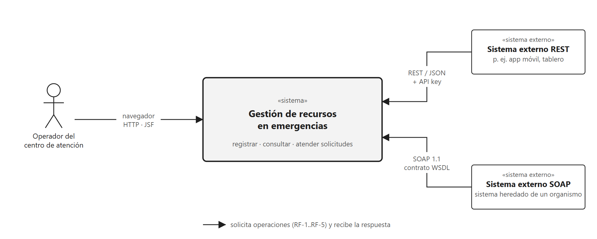
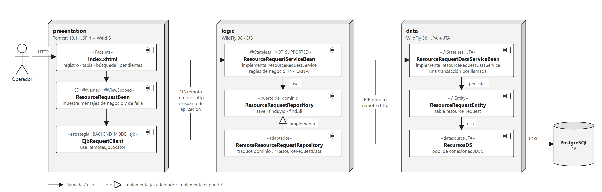
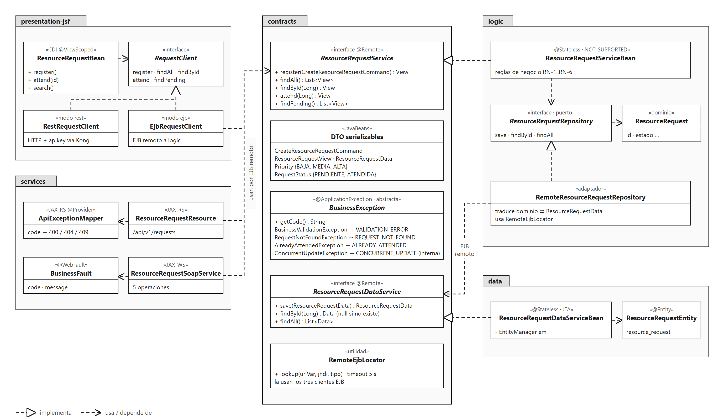
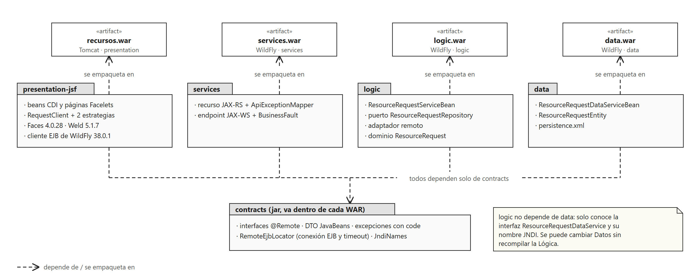
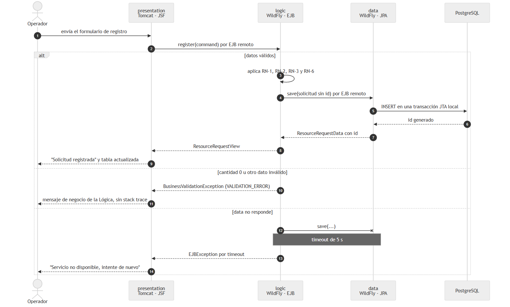
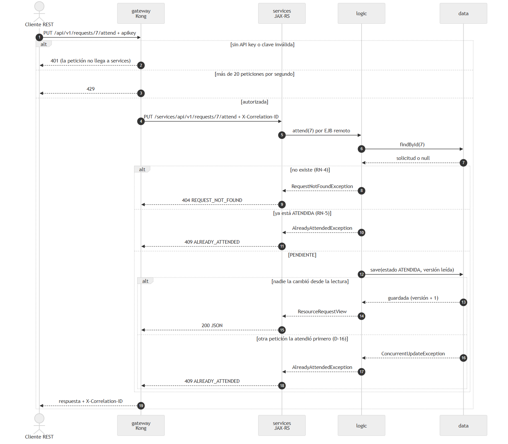
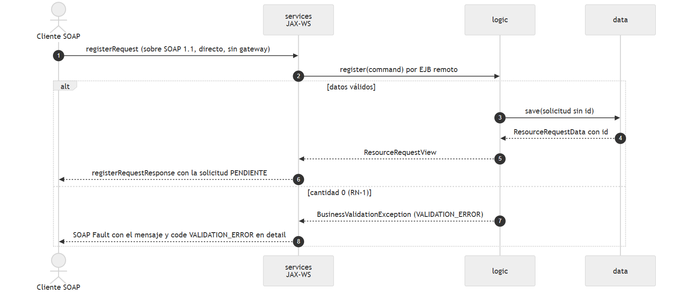
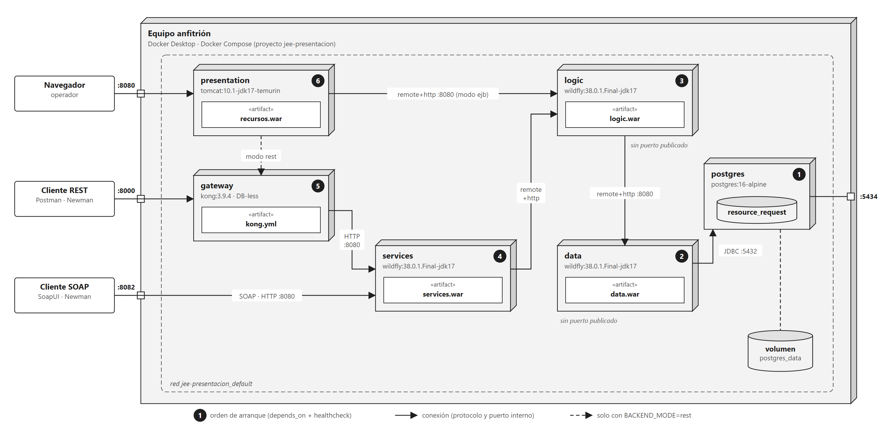

# Diseño arquitectónico del sistema de gestión de solicitudes de recursos en emergencias

Taller No. 4 · Jakarta EE: presentación, capas distribuidas y servicios

Arquitectura de Software · Pontificia Universidad Javeriana

Integrantes: Andrés Barrios, André Landinez

Bogotá, octubre de 2026

## 1. Propósito y alcance

### 1.1 Propósito del diseño

Este documento describe la arquitectura del sistema de gestión de solicitudes de recursos en emergencias y justifica
las decisiones que la componen. El sistema conserva el dominio y las reglas de negocio construidos en el Taller No. 2,
les agrega una capa de presentación web y distribuye las capas en servidores independientes. Sobre esa base se
incorpora una capa de servicios con interfaces REST y SOAP y un API Gateway, de modo que la misma lógica de negocio
atienda a clientes heterogéneos.

El diseño se documenta con el modelo de vistas 4+1. Cada decisión se justifica a partir de los drivers
arquitectónicos, con sus alternativas, sus compromisos y la evidencia que la respalda.

### 1.2 Alcance

Se diseña e implementa el sistema completo en tres etapas acumulativas:

- **Etapa 1.** Presentación JSF en un servidor web (Tomcat), lógica de negocio y acceso a datos en dos servidores de
  aplicaciones (WildFly) y una base de datos relacional (PostgreSQL). Las capas se comunican por EJB remoto.
- **Etapa 2.** Una capa de servicios que expone la lógica de negocio por REST y SOAP a clientes externos.
- **Etapa 3.** Un API Gateway delante de la interfaz REST, que concentra el control de acceso, la limitación de la
  demanda y la correlación de peticiones. La interfaz SOAP se consume directamente en la capa de servicios.

Las tres etapas conviven en el mismo despliegue. La presentación JSF puede operar como cliente de la etapa 1 (EJB
remoto) o de la etapa 3 (REST a través del gateway) según su configuración.

Quedan fuera del alcance la alta disponibilidad con réplicas, la autenticación de usuarios finales, el cifrado del
transporte y la orquestación de contenedores.

### 1.3 Supuestos

Tabla 1. Supuestos del diseño.

| ID | Supuesto | Justificación |
|---|---|---|
| S-1 | Las tres etapas son evoluciones de un mismo sistema y se implementan todas | Las tres comparten la lógica de negocio; la capa de servicios aparece en las etapas 2 y 3 |
| S-2 | El dominio es el de solicitudes de recursos en emergencias del Taller No. 2 | Permite concentrar el trabajo en la arquitectura y no en reglas nuevas |
| S-3 | Los requisitos funcionales son los del Taller No. 2, ahora con persistencia real | El aporte de este trabajo es la distribución y la exposición de servicios |
| S-4 | El despliegue se hace con Docker Compose en un solo anfitrión | El problema exige servidores separados, no orquestación ni escalado automático |
| S-5 | El servidor de aplicaciones es WildFly 38 | El enunciado admite WildFly o Payara; WildFly ofrece un cliente EJB remoto documentado para Tomcat |
| S-6 | El API Gateway aplica solo a la interfaz REST | El esquema de la etapa 3 conecta el cliente SOAP directamente con la capa de servicios |

## 2. Contexto y restricciones

### 2.1 Contexto del sistema

El sistema registra las solicitudes de recursos que se generan durante una emergencia y permite hacer seguimiento a su
atención. Lo usan tres tipos de actores (figura 1): los operadores del centro de atención, que registran, consultan y atienden
solicitudes desde un navegador; los sistemas externos que se integran mediante JSON sobre HTTP, con control de
acceso y de demanda; y los sistemas heredados de los organismos de gestión del riesgo, que requieren un contrato
WSDL formal.

### 2.2 Restricciones

Tabla 2. Restricciones.

| ID | Restricción | Origen |
|---|---|---|
| CON-1 | Presentación con JSF en un servidor web; lógica y datos en servidores de aplicaciones separados | Enunciado, etapa 1 |
| CON-2 | Capa de servicios con REST y SOAP, y API Gateway delante de REST | Enunciado, etapas 2 y 3 |
| CON-3 | Jakarta EE 10 y Java 17; la lógica de negocio se implementa con EJB sin estado y se desacopla de los datos mediante un puerto | Continuidad con el Taller No. 2 |
| CON-4 | El sistema debe construirse y ejecutarse desde una copia limpia del repositorio, sin pasos manuales | Reproducibilidad de la entrega |

## 3. Drivers arquitectónicos

### 3.1 Funcionalidad primaria

Tabla 3. Requisitos funcionales y su exposición por cliente.

| ID | Operación | Presentación JSF | REST (a través del gateway) | SOAP |
|---|---|---|---|---|
| RF-1 | Registrar una solicitud | Formulario | `POST /api/v1/requests` | `registerRequest` |
| RF-2 | Consultar todas las solicitudes | Tabla | `GET /api/v1/requests` | `listRequests` |
| RF-3 | Consultar una solicitud por identificador | Búsqueda | `GET /api/v1/requests/{id}` | `getRequest` |
| RF-4 | Atender una solicitud | Botón por fila | `PUT /api/v1/requests/{id}/attend` | `attendRequest` |
| RF-5 | Consultar las solicitudes pendientes | Filtro | `GET /api/v1/requests/pending` | `listPendingRequests` |

### 3.2 Reglas de negocio

Las reglas residen únicamente en la capa de lógica. La presentación puede validar el formato de los campos para
mejorar la experiencia de uso, pero la regla y su mensaje provienen siempre de la lógica, de modo que un mismo dato
inválido produce el mismo código y el mismo mensaje en JSF, REST y SOAP.

Tabla 4. Reglas de negocio.

| ID | Regla | Código de error |
|---|---|---|
| RN-1 | La cantidad solicitada debe ser mayor que cero | `VALIDATION_ERROR` |
| RN-2 | La descripción del desastre y el tipo de recurso son obligatorios | `VALIDATION_ERROR` |
| RN-3 | Toda solicitud nueva inicia en estado `PENDIENTE` | — |
| RN-4 | No se puede atender una solicitud inexistente | `REQUEST_NOT_FOUND` |
| RN-5 | Una solicitud se atiende una sola vez, incluso ante peticiones simultáneas | `ALREADY_ATTENDED` |
| RN-6 | La prioridad es obligatoria y debe ser `BAJA`, `MEDIA` o `ALTA` | `VALIDATION_ERROR` |

### 3.3 Escenarios de atributos de calidad

Cada escenario se expresa con sus seis partes y una medida verificable. La prioridad indica la importancia para el
negocio y la dificultad arquitectónica en la escala alta (H), media (M) y baja (L).

Tabla 5. Escenarios de atributos de calidad.

| ID | Atributo | Fuente y estímulo | Artefacto y entorno | Respuesta y medida | Prioridad |
|---|---|---|---|---|---|
| QA-MOD-1 | Modificabilidad | El equipo de desarrollo necesita que la presentación deje de consumir la lógica por EJB y consuma los servicios a través del gateway | Presentación JSF, en despliegue | El cambio se realiza por configuración. Medida: ninguna línea modificada en las capas de lógica y datos; solo cambia la variable `BACKEND_MODE` | (H, M) |
| QA-INT-1 | Interoperabilidad | Un sistema externo no Java ejecuta RF-1 a RF-5 por REST y por SOAP | Capa de servicios, en operación normal | Resultados equivalentes por ambos protocolos y WSDL consumible. Medida: el 100 % de las aserciones de las pruebas de API se cumple | (H, M) |
| QA-SEG-1 | Seguridad | Un cliente envía una petición REST sin clave de API o con una clave inválida | API Gateway, en operación normal | La petición se rechaza en el gateway. Medida: respuesta 401 y ninguna petición registrada en la capa de servicios | (H, L) |
| QA-DIS-1 | Disponibilidad | Falla del servidor de la capa de datos | Cadena de presentación, lógica y datos, en operación normal | Error controlado, sin trazas internas, y recuperación automática. Medida: error en 5 s o menos y recuperación sin reiniciar las demás capas | (H, H) |
| QA-DIS-2 | Disponibilidad ante picos | Un cliente REST envía una ráfaga de 50 peticiones simultáneas | API Gateway y capa de servicios, en sobrecarga | El gateway limita la demanda. Medida: respuesta 429 por encima de 20 peticiones por segundo y la capa de servicios sigue respondiendo | (M, L) |
| QA-REN-1 | Rendimiento comparativo | Un usuario realiza 100 consultas de RF-2 por cada camino | Caminos de las etapas 1, 2 y 3, en operación normal y sin carga concurrente | Se cuantifica el costo de cada intermediario. Medida: percentiles 50 y 95 por camino | (M, M) |

## 4. Evolución de la arquitectura

### 4.1 Etapa 1: capas distribuidas

El estilo de la etapa 1 es de capas distribuidas, del tipo llamada y retorno: cada capa invoca solo a la inmediatamente
inferior, mediante EJB remoto y con un usuario de aplicación. Las reglas de negocio del Taller No. 2 no cambian; el
puerto `ResourceRequestRepository`, que antes implementaba un repositorio local, ahora lo implementa un adaptador
remoto que invoca a la capa de datos (D-3).

### 4.2 Etapas 2 y 3: capa de servicios y API Gateway

En la etapa 2, la capa de servicios actúa como una fachada sin reglas de negocio (D-5): traduce cada protocolo al
contrato de la lógica y cada error de negocio al formato del protocolo. La lógica no conoce HTTP ni XML.

En la etapa 3, el API Gateway aplica la autenticación por clave, la limitación de la demanda y la correlación de
peticiones mediante configuración, sin código propio (D-6). La interfaz SOAP se consume directamente en la capa de
servicios (D-7). La misma aplicación JSF, con solo cambiar una variable de entorno, deja de usar EJB y consume los
servicios a través del gateway (D-8). La figura 3 muestra las dos etapas.

### 4.3 Comparación de las etapas

Tabla 6. Comparación de las tres etapas.

| Criterio | Etapa 1: capas con EJB | Etapa 2: servicios | Etapa 3: servicios con gateway |
|---|---|---|---|
| Acoplamiento del cliente | Alto: requiere el contrato Java y el cliente EJB de WildFly | Bajo: HTTP con JSON o SOAP con WSDL | Bajo; el cliente REST solo conoce la dirección del gateway |
| Saltos de red en RF-2 | 2 | 3 | 4 por REST y 3 por SOAP |
| Interoperabilidad | Solo clientes Java | Cualquier cliente HTTP o SOAP | Igual, con un único punto de entrada REST |
| Seguridad | Usuario de aplicación en cada invocación EJB | Igual; los servicios no tienen control propio | Clave de API y límite de demanda en el gateway; SOAP sin esos controles (R-1) |
| Manejo de fallos | Tiempo máximo de invocación EJB (D-14) | Igual, más la traducción a errores HTTP y SOAP Fault | Igual, más el rechazo con 429 ante picos |
| Complejidad operativa | Tres servidores y la base de datos | Cuatro servidores y la base de datos | Cinco servidores y la base de datos |
| Latencia de RF-2 (percentiles 50 y 95) | 26,6 ms y 38,1 ms (página completa) | 18,4 ms y 33,2 ms | 19,0 ms y 31,4 ms |

## 5. Vista lógica

La vista lógica organiza el sistema en cinco módulos. Los cuatro módulos de capa dependen únicamente del módulo de
contratos y nunca entre sí, lo que materializa el desacoplamiento de las decisiones D-3 y D-4 (figura 4).

Tabla 7. Módulos de la vista lógica.

| Módulo | Elementos principales | Responsabilidad |
|---|---|---|
| contracts | `ResourceRequestService`, `ResourceRequestDataService`, objetos de transferencia, `BusinessException`, `RemoteEjbLocator` | Contratos remotos compartidos, errores de negocio con código estable y política única de conexión EJB (D-14) |
| logic | `ResourceRequestServiceBean`, puerto `ResourceRequestRepository` y adaptador remoto | Reglas RN-1 a RN-6; traduce entre el dominio y el contrato de datos; no propaga transacciones (D-11) |
| data | `ResourceRequestDataServiceBean`, entidad JPA | Persistencia; cada invocación es una transacción local con control de versión (D-16) |
| services | Recurso REST y servicio SOAP | Traducen protocolos y errores sin aplicar reglas (D-5) |
| presentation-jsf | Controlador de la página y `RequestClient` con dos implementaciones | Interfaz de usuario y estrategia de acceso al backend según `BACKEND_MODE` (D-8) |

Una solicitud nace en estado `PENDIENTE` (RN-3) y pasa a `ATENDIDA` al atenderse; un segundo intento se rechaza
(RN-5). Solo la lógica cambia el estado; la capa de datos almacena el valor recibido sin validar transiciones.

## 6. Vista de desarrollo

Cada módulo de Maven produce un artefacto que se despliega en su propio servidor: `data.war`, `logic.war` y
`services.war` en WildFly y `recursos.war` en Tomcat. El módulo de contratos se empaqueta dentro de cada artefacto
(figura 5).

La lógica conoce a la capa de datos únicamente por su interfaz remota y su nombre JNDI. La implementación de datos
puede cambiar de base de datos, de servidor o de mecanismo de persistencia sin recompilar la lógica, siempre que
respete el contrato. Es la misma inversión de dependencias del Taller No. 2, ahora entre procesos.

Cada imagen de contenedor se construye en dos etapas: la primera compila el módulo con Maven y la segunda copia el
artefacto al servidor. De esta forma, una copia limpia del repositorio no requiere Java ni Maven instalados (CON-4).

## 7. Vista de procesos

Las tres secuencias siguientes cubren los tres tipos de cliente e incluyen sus caminos de error, para mostrar dónde se
origina cada error y cómo llega al cliente.

### 7.1 Registro de una solicitud desde la presentación JSF

Las reglas RN-1, RN-2, RN-3 y RN-6 se evalúan en la lógica y su mensaje llega sin modificaciones a la página. Si la
capa de datos no responde, el tiempo máximo de invocación (D-14) limita la espera a 5 segundos y la página muestra un
mensaje controlado (QA-DIS-1).

### 7.2 Atención de una solicitud por REST a través del gateway

El gateway rechaza las peticiones sin clave (401) o por encima del límite (429) antes de que lleguen a la capa de
servicios. Las reglas RN-4 y RN-5 se aplican en la lógica y la capa de servicios solo las traduce a 404 y 409. La
lectura y la escritura de la solicitud son dos transacciones locales de la capa de datos (D-11); si dos peticiones
intentan atender la misma solicitud al mismo tiempo, el control de versión (D-16) acepta solo la primera y la otra
recibe el mismo 409 que un segundo intento.

### 7.3 Registro de una solicitud por SOAP

El mismo error de negocio de la figura 6 llega al cliente SOAP como un Fault con el mismo código. En los tres casos la
excepción de negocio viaja intacta por EJB remoto, con su clase, su código y su mensaje, porque está marcada como
excepción de aplicación y es serializable.

## 8. Vista física

Cada capa se despliega en un contenedor independiente dentro de una misma red (figura 9). Solo se publican los
puertos que requieren los clientes: 8080 para la presentación, 8000 para el gateway y 8082 para la interfaz SOAP; la
lógica y los datos solo son accesibles dentro de la red.

Los contenedores arrancan en orden (base de datos, datos, lógica, servicios, gateway y presentación) y cada uno espera
a que el anterior supere su verificación de salud. Cada invocación EJB se autentica con un usuario de aplicación de
WildFly, que se crea al arrancar el contenedor para que la contraseña no quede en la imagen. Las direcciones, las
credenciales y el modo de la presentación se configuran con variables de entorno.

Cada capa tiene un solo nodo. Esta configuración es suficiente para el alcance definido, pero cada capa constituye un
punto único de falla (R-4).

## 9. Escenarios

Los cinco casos de uso son los mismos para los tres actores del contexto. La tabla 8 muestra cómo recorre cada uno
las vistas anteriores.

Tabla 8. Recorrido de los casos de uso por las vistas.

| Caso de uso | Vista lógica | Vista de desarrollo | Vista de procesos | Vista física |
|---|---|---|---|---|
| RF-1 registrar | `register` con RN-1, RN-2, RN-3 y RN-6 | logic y data | Figuras 6 y 8 | Presentación, lógica, datos y base de datos |
| RF-1 con cantidad 0 | `BusinessValidationException` | contracts | Figuras 6 y 8, camino de error | Igual en los tres clientes |
| RF-2 consultar todas | `findAll` | data | Análogo a la figura 6 | Los tres caminos medidos en QA-REN-1 |
| RF-3 consultar por identificador | `findById`; un valor nulo produce `RequestNotFoundException` | Adaptador remoto | Figura 7, camino 404 | Servicios, lógica y datos |
| RF-4 atender | `attend` con RN-4 y RN-5 | logic | Figura 7 | Gateway, servicios, lógica y datos |
| RF-5 consultar pendientes | `findPending`, con el filtro en la lógica | logic | Análogo a la figura 6 | Todos los clientes |

## 10. Decisiones arquitectónicas y tácticas

### 10.1 Decisiones

Cada decisión parte de un driver, considera alternativas y declara el compromiso que asume. La tabla 9 recoge las
decisiones arquitectónicas; las de implementación se listan al final de esta sección.

Tabla 9. Decisiones arquitectónicas.

| ID | Decisión | Driver | Alternativas descartadas | Compromiso | Evidencia |
|---|---|---|---|---|---|
| D-1 | Estilo de capas distribuidas que evoluciona a una capa de servicios | CON-1, CON-2, QA-INT-1 | Aplicación en capas desplegada en un solo servidor | Aísla y despliega cada capa por separado y habilita la interoperabilidad, a cambio de latencia y complejidad operativa | QA-REN-1 |
| D-2 | EJB remoto sobre `remote+http` entre presentación y lógica, y entre lógica y datos | CON-1, CON-3 | REST interno; RMI-IIOP | Contrato tipado y excepciones de negocio intactas sin escribir serialización; acopla a los clientes con Java y WildFly, lo que resuelve la etapa 3 | Prueba de concepto 1 y 2 |
| D-3 | Puerto y adaptador del Taller No. 2 para distribuir la capa de datos | QA-MOD-1, CON-3 | Invocar el EJB de datos directamente desde la lógica | Reglas de negocio intactas; el adaptador agrega una traducción entre dominio y objeto de transferencia | Código de la capa de lógica |
| D-4 | Módulo de contratos compartido | D-2 | Copiar las clases en cada módulo | Un único contrato; un cambio obliga a recompilar los clientes, lo cual es aceptable con una sola construcción | Vista de desarrollo |
| D-5 | Fachada de servicios sin reglas, con REST y SOAP | QA-INT-1 | Exponer REST desde la lógica | La lógica permanece independiente del protocolo, a cambio de un salto de red adicional | QA-INT-1, QA-REN-1 |
| D-6 | Kong 3.9 sin base de datos como API Gateway, con autenticación por clave, limitación de demanda y correlación | QA-SEG-1, QA-DIS-2 | NGINX; Spring Cloud Gateway; sin gateway | Controles declarados en un archivo, sin código; agrega un componente y un punto único de falla (R-4) | QA-SEG-1, QA-DIS-2 |
| D-7 | Interfaz SOAP consumida directamente en la capa de servicios | Esquema de la etapa 3 | Enrutar SOAP por el gateway | Fiel al esquema propuesto; SOAP queda sin clave ni límite de demanda (R-1) | — |
| D-8 | Patrón Strategy en la presentación, seleccionado con `BACKEND_MODE` | QA-MOD-1 | Dos aplicaciones JSF | Una sola interfaz de usuario para dos etapas; la variante REST agrega un cliente HTTP | QA-MOD-1 |
| D-10 | Usuario de aplicación en cada invocación EJB y clave de API en el gateway | QA-SEG-1 | Sin seguridad; OAuth 2.0 con JWT y TLS | Suficiente para el alcance; OAuth 2.0 y TLS se difieren por no existir un driver que los exija | QA-SEG-1 |
| D-11 | Transacciones JTA locales a la capa de datos; la lógica no propaga transacciones | Integridad, simplicidad | Propagar la transacción entre servidores con XA | Sin coordinador distribuido ni confirmación en dos fases por red; la atención usa dos transacciones (R-5) | Prueba de concepto 2 |
| D-14 | Tiempo máximo de invocación EJB de 5 s, con una política de conexión común | QA-DIS-1 | Sin tiempo máximo; tiempos distintos por cliente | Detecta fallas en 5 s; una operación legítima más lenta fallaría (punto de sensibilidad) | 135 s sin tiempo máximo; con 10 s configurados, la falla se detectó a los 10 s |
| D-16 | Control de versión optimista en la capa de datos; la lógica traduce el conflicto a `ALREADY_ATTENDED` | RN-5, R-5 | Bloqueo pesimista; operación atómica condicionada en la capa de datos | El bloqueo pesimista exige una transacción que abarque lectura y escritura, en conflicto con D-11; la operación condicionada llevaría una regla de negocio a la capa de datos. La opción elegida conserva D-11 y deja la regla en la lógica, a cambio de un campo de versión en el contrato interno | Prueba de concurrencia |
| D-17 | Precalentamiento de cada capa durante su despliegue, antes de declararse disponible | QA-DIS-1, D-14 | Aumentar el tiempo máximo a 10 s; reintentar la invocación | Conserva la detección en 5 s y evita que el primer usuario pague el costo de arranque; el despliegue tarda cerca de 1 s más | La primera invocación tras reiniciar la capa de datos baja de unos 800 ms a menos de 100 ms |

Decisiones de implementación:

- **D-9.** WildFly 38 como servidor de aplicaciones, por su cliente EJB remoto documentado para Tomcat (S-5).
- **D-12.** Despliegue con Docker Compose y verificaciones de salud, sin orquestador (S-4, CON-4).
- **D-13.** Objetos de transferencia como JavaBeans serializables, compatibles con JSF y con JAXB.
- **D-15.** Contenedores de lógica y datos sin puertos publicados, para limitar la exposición.

### 10.2 Tácticas por escenario

Tabla 10. Tácticas aplicadas.

| Escenario | Tácticas | Elementos |
|---|---|---|
| QA-MOD-1 | Encapsular; usar un intermediario; restringir dependencias; diferir el enlace a la configuración del despliegue | `RequestClient` y `BACKEND_MODE`; módulo de contratos; puerto y adaptador |
| QA-INT-1 | Adherirse a estándares; adaptar la interfaz; usar un intermediario | Capa de servicios |
| QA-SEG-1 | Autenticar actores; limitar el acceso; limitar la exposición | Autenticación por clave en el gateway; usuario de aplicación EJB; lógica y datos sin puertos publicados |
| QA-DIS-1 | Detectar excepciones; tiempo máximo; manejar excepciones; reintroducir el componente sin reiniciar los demás; precalentar antes de reintroducir | `RemoteEjbLocator`; manejo de errores en JSF, REST y SOAP; precalentamiento (D-17); verificaciones de salud |
| QA-DIS-2 | Gestionar las peticiones de trabajo; limitar la respuesta a eventos | Limitación de demanda en el gateway |
| Trazabilidad operativa | Auditar mediante la correlación de peticiones | Identificador de correlación del gateway y registro de acceso de la capa de servicios |

## 11. Riesgos, puntos de sensibilidad y compromisos

### 11.1 Riesgos

Tabla 11. Riesgos arquitectónicos.

| ID | Riesgo | Causa | Consecuencia | Mitigación |
|---|---|---|---|---|
| R-1 | Las interfaces SOAP y REST directa no tienen clave ni límite de demanda | D-7; capa de servicios publicada | Un cliente puede evitar los controles del gateway | En producción, publicar solo el gateway y enrutar SOAP por él, o aplicar WS-Security |
| R-2 | Latencia acumulada por los saltos de red | D-1, D-5, D-6 | Cada capa suma tiempo de red y de serialización | Medida en QA-REN-1; aceptable para un dominio de operación humana |
| R-3 | Clientes de la etapa 1 acoplados a Java y WildFly | D-2 | La interfaz de usuario no puede cambiar de plataforma sin cambiar de protocolo | Resuelto por la etapa 3 (`BACKEND_MODE=rest`) |
| R-4 | Puntos únicos de falla en el gateway y en cada capa | D-6, D-12 | La caída de un contenedor deja sin servicio a sus clientes | Detección rápida (D-14) y recuperación automática; réplicas detrás de un balanceador si se exigiera mayor disponibilidad |
| R-5 | Dos atenciones simultáneas de la misma solicitud | D-11 | Doble atención en una ventana estrecha | Mitigado con D-16: la segunda escritura se rechaza y el cliente recibe 409 |
| R-6 | Credenciales y clave de API por defecto en la configuración | Comodidad del entorno académico | Un despliegue sin cambios expone las claves | Sobrescribirlas con variables de entorno o un archivo no versionado |

### 11.2 Puntos de sensibilidad

- **Tiempo máximo de invocación EJB (D-14).** Un valor menor mejora la detección de fallas, pero aumenta los falsos
  positivos ante una lentitud transitoria de una capa sana.
- **Límite de peticiones del gateway (D-6).** Un límite menor protege mejor a la capa de servicios, pero rechaza
  tráfico legítimo durante los picos.
- **Control de versión optimista (D-16).** Con alta contención sobre una misma solicitud aumentan los rechazos. En
  este dominio la contención es baja, porque cada solicitud la atiende un operador.

### 11.3 Compromisos principales

- **Distribución frente a rendimiento (D-1, D-2).** Aislamiento y despliegue independiente de cada capa a cambio de
  latencia.
- **Gateway frente a disponibilidad y latencia (D-6).** Seguridad y control de la demanda a cambio de un salto
  adicional y un punto único de falla.
- **Interoperabilidad frente a simplicidad (D-5, D-13).** Soporte de clientes no Java a cambio de una capa de
  traducción y de objetos de transferencia más extensos.

## 12. Trazabilidad

Tabla 12. Trazabilidad de los drivers a la evidencia.

| Driver | Escenario | Decisiones | Elementos | Vista | Evidencia (Anexo A) |
|---|---|---|---|---|---|
| CON-1 | QA-MOD-1 | D-3, D-4, D-8 | `RequestClient`, puerto y adaptador, contratos | Lógica y desarrollo | E-5 |
| CON-2 | QA-INT-1 | D-5, D-13 | Capa de servicios | Lógica y procesos | E-1 |
| CON-2 | QA-SEG-1 | D-6, D-10, D-15 | Gateway | Física | E-2 |
| Operación continua | QA-DIS-1 | D-11, D-14, D-17 | `RemoteEjbLocator`, verificaciones de salud | Procesos y física | E-4, E-9 |
| Picos de demanda | QA-DIS-2 | D-6 | Gateway | Física | E-3 |
| Costo de la distribución | QA-REN-1 | D-1, D-5, D-6 | Los tres caminos | Evolución | E-6 |
| RN-1 a RN-6 | Error de negocio igual en los tres clientes | D-2, D-4, D-5 | `BusinessException` y traductores | Procesos | E-1, E-7, E-8 |

## 13. Validación y resultados

La validación se ejecutó sobre el sistema completo, con los seis contenedores en funcionamiento. Las cifras de esta
sección corresponden a las salidas de las pruebas, que se conservan en el repositorio (Anexo A).

Tabla 13. Resultados de los escenarios de calidad.

| Escenario | Resultado | Cumple |
|---|---|---|
| QA-INT-1 | Pruebas de API: REST a través del gateway 47 de 47 aserciones, REST directo 47 de 47 y SOAP 35 de 35 | Sí |
| QA-SEG-1 | 401 sin clave y con clave inválida; solo la petición con clave válida llegó a la capa de servicios | Sí |
| QA-DIS-2 | Ráfaga de 50 peticiones en 892 ms: 32 atendidas y 18 rechazadas con 429; la capa de servicios respondió con normalidad inmediatamente después | Sí |
| QA-DIS-1 | Con la capa de datos detenida, JSF y REST responden en 155 ms o menos con un mensaje controlado y sin trazas; al reiniciar solo la capa de datos, ambos clientes vuelven a mostrar datos sin reiniciar las demás capas | Sí |
| QA-MOD-1 | La misma imagen de la presentación opera en modo EJB, REST y de nuevo EJB; solo en modo REST llegan peticiones a la capa de servicios; ninguna modificación en las capas de lógica y datos | Sí |
| QA-REN-1 | Percentiles 50 y 95: etapa 1, 26,6 ms y 38,1 ms; etapa 2, 18,4 ms y 33,2 ms; etapa 3, 19,0 ms y 31,4 ms | Medido |
| RN-5 con concurrencia | Diez atenciones simultáneas de la misma solicitud: una respuesta 200 y nueve respuestas 409; la solicitud queda atendida una sola vez | Sí |

El gateway agrega menos de 1 ms a la mediana (etapa 2 frente a etapa 3), un costo despreciable frente a los controles
que aporta. La diferencia de la etapa 1 se explica principalmente porque su medición incluye la generación completa de
la página. Para un dominio de operación humana, ninguna de las cifras representa una limitación.

Además, las 89 pruebas unitarias de los cinco módulos se ejecutaron con éxito y dos pruebas de concepto previas
validaron la comunicación por EJB remoto entre Tomcat y WildFly y entre servidores WildFly. Las mediciones que
sustentan el tiempo máximo de invocación (D-14) y el precalentamiento (D-17) se encuentran en el Anexo A.

## 14. Conclusiones

El sistema cumple los seis escenarios de calidad definidos y los requisitos funcionales en los tres tipos de cliente.
La evolución en tres etapas permitió medir el costo de cada intermediario: la distribución en capas y la fachada de
servicios agregan pocos milisegundos y el gateway menos de uno, mientras que aportan aislamiento, interoperabilidad y
control centralizado del acceso y de la demanda.

Las decisiones de mayor impacto fueron mantener las reglas de negocio en una sola capa y comunicar las capas mediante
contratos compartidos. Gracias a ello, el mismo error de negocio llega con el mismo código a JSF, REST y SOAP, y la
presentación cambia de etapa sin modificar las capas de lógica y datos.

La distribución introdujo problemas que no existían en una aplicación local: la concurrencia entre transacciones
separadas, el costo de la primera invocación tras un arranque y la detección de fallas de red. Cada uno se resolvió
con una táctica explícita (control de versión optimista, precalentamiento y tiempo máximo de invocación) cuya
efectividad se midió.

Como trabajo futuro quedan la replicación de las capas para eliminar los puntos únicos de falla, el enrutamiento de
SOAP por el gateway y la incorporación de TLS y de un esquema de autenticación de usuarios finales.

## 15. Referencias

- Bass, L., Clements, P. y Kazman, R. (2021). *Software Architecture in Practice* (4.ª ed.). Addison-Wesley.
- Cervantes, H. y Kazman, R. (2016). *Designing Software Architectures: A Practical Approach*. Addison-Wesley.
- Kruchten, P. (1995). Architectural Blueprints: The "4+1" View Model of Software Architecture. *IEEE Software*,
  12(6), 42-50.
- Richards, M. (2022). *Software Architecture Patterns* (2.ª ed.). O'Reilly Media.
- Eclipse Foundation. (2022). *Jakarta EE Platform 10 Specification*.
- Red Hat. (2025). *WildFly Developer Guide: EJB Invocations from a Remote Client*.
- Kong Inc. (2025). *Kong Gateway 3.9 Documentation*.

## Anexo A. Evidencias

Las salidas completas de las pruebas se conservan en el repositorio del proyecto.

Tabla 14. Evidencias de validación.

| ID | Evidencia | Ubicación en el repositorio |
|---|---|---|
| E-1 | Pruebas de API REST y SOAP | `docs/evidencias/qa/QA-INT-1-*.txt` |
| E-2 | Seguridad en el gateway | `docs/evidencias/qa/QA-SEG-1-*.txt` |
| E-3 | Limitación de la demanda | `docs/evidencias/qa/QA-DIS-2-*.txt` |
| E-4 | Disponibilidad ante la caída de la capa de datos | `docs/evidencias/qa/QA-DIS-1-*.txt` |
| E-5 | Cambio de etapa de la presentación | `docs/evidencias/qa/QA-MOD-1-*.txt` |
| E-6 | Medición de latencia | `docs/evidencias/qa/QA-REN-1-*.txt` |
| E-7 | Atención concurrente | `docs/evidencias/qa/RN-5-CONCURRENCIA-*.txt` |
| E-8 | Recorrido de la presentación JSF | `docs/evidencias/jsf/` |
| E-9 | Pruebas de concepto, tiempo máximo y precalentamiento | `docs/evidencias/spikes.md`, `docs/evidencias/calentamiento.md` |
