# Arquitectura — Gestión de Recursos en Emergencias: presentación, capas distribuidas y servicios

Taller 4 JEE · Arquitectura de Software · Pontificia Universidad Javeriana · 2026-30

El Taller 4 junta las capas que la serie de talleres JEE construyó por separado (Datos con JPA/JTA en el T1,
Negocio con EJB en el T2), les agrega una capa de **Presentación** con JSF y las despliega en **servidores
separados**. Luego introduce una **capa de servicios** (REST y SOAP) y un **API Gateway**, de modo que la misma
Lógica sirva a clientes heterogéneos. El documento sigue el modelo **4+1** del T2 y la metodología del curso:
drivers con escenarios medibles, decisiones con alternativas y trade-offs, riesgos y trazabilidad.

| Sección | Pregunta que responde |
|---|---|
| [1. Contexto y alcance](#1-contexto-y-alcance) | ¿Qué pidió el profesor y cómo se interpretó? |
| [2. Drivers](#2-drivers-arquitectónicos) | ¿Qué requisitos y atributos de calidad guían el diseño? |
| [3. Evolución ① → ② → ③](#3-evolución-de-la-arquitectura----) | ¿Qué cambia en cada etapa del tablero y qué se gana o pierde? |
| [4. Vista lógica](#4-vista-lógica) | ¿Qué clases y contratos componen el sistema? |
| [5. Vista de desarrollo](#5-vista-de-desarrollo) | ¿Cómo se organiza el código y hacia dónde van las dependencias? |
| [6. Vista de procesos](#6-vista-de-procesos) | ¿Cómo colaboran las capas en tiempo de ejecución? |
| [7. Vista física](#7-vista-física--despliegue) | ¿Dónde corre cada capa y por qué protocolos se habla? |
| [8. Escenarios (+1)](#8-escenarios-1) | ¿Cómo recorren los casos de uso las vistas? |
| [9. Decisiones y tácticas](#9-decisiones-arquitectónicas-y-tácticas) | ¿Por qué se diseñó así y qué alternativas se descartaron? |
| [10. Riesgos](#10-riesgos-puntos-de-sensibilidad-y-trade-offs) | ¿Qué puede salir mal y dónde son sensibles los atributos? |
| [11. Trazabilidad](#11-trazabilidad) | ¿Qué decisión, elemento y evidencia respaldan cada escenario? |
| [12. Resultados](#12-resultados-de-pruebas) | ¿Qué se midió y con qué resultado? |

---

## 1. Contexto y alcance

### 1.1 Consigna

No hay enunciado escrito: el profesor dibujó tres esquemas en el tablero.

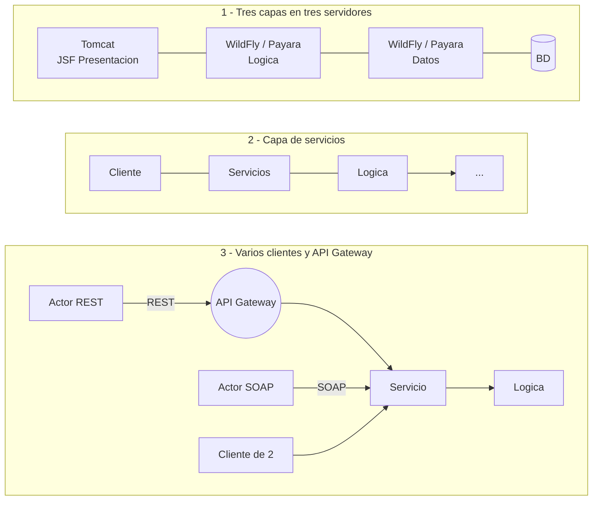

### 1.2 Interpretación y supuestos

| ID | Supuesto | Por qué es razonable | Si el profesor indica otra cosa |
|---|---|---|---|
| S-1 | ①, ② y ③ son **etapas acumulativas de un mismo sistema** y se implementan las tres | Los esquemas reutilizan piezas: Lógica aparece en los tres, Servicio en ② y ③, y la caja cliente de ② reaparece en ③ | Si era "elegir una", las tres siguen siendo válidas como evolución |
| S-2 | **Dominio:** solicitudes de recursos en emergencias del T2 | Es el tier de negocio que el curso ya pidió; el T4 le agrega presentación y lo distribuye | Cambian el modelo y las pantallas; la arquitectura se mantiene |
| S-3 | **Requisitos funcionales = los del T2**, ahora con persistencia real (JPA + PostgreSQL) | El foco del T4 es la arquitectura, no reglas nuevas | Se agregan los que pida |
| S-4 | Entregables: código, diseño arquitectónico y evidencias de funcionamiento | Es lo que se pidió en los talleres anteriores | — |
| S-5 | Despliegue con **Docker Compose**, sin Kubernetes | El tablero habla de servidores, no de orquestación; Kubernetes agrega trabajo sin un driver que lo exija | Se reutilizan los manifiestos del T3 |
| S-6 | Servidor de aplicaciones **WildFly 38** (el tablero permite WildFly o Payara) | Experiencia del T3 y cliente EJB remoto documentado para Tomcat | — |
| S-7 | El API Gateway aplica **solo a REST**; SOAP entra directo al servicio | Así está dibujado en ③ | Se agrega una ruta SOAP en el gateway |

Preguntas abiertas para el profesor: (1) ¿etapas o elegir una?, (2) ¿dominio libre o el del T2?, (3) ¿implementar el
gateway o solo diseñarlo?, (4) ¿producto obligatorio (Payara, gateway, PrimeFaces)?, (5) ¿Kubernetes o basta Docker?

### 1.3 Diagrama de contexto

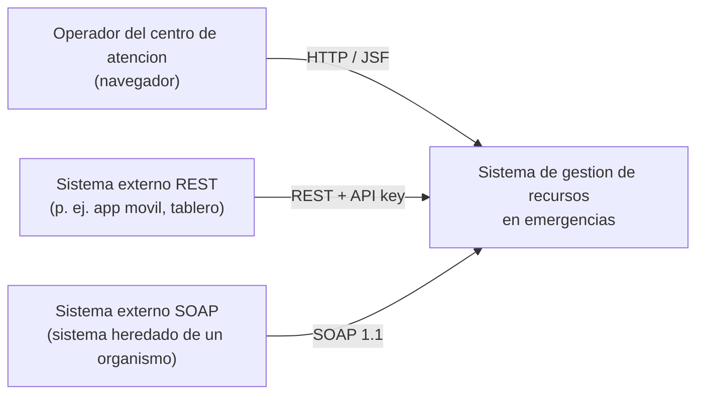

| Actor | Necesidad |
|---|---|
| Operador del centro de atención | Registrar, consultar y atender solicitudes desde un navegador |
| Sistema externo REST | Integrarse con JSON sobre HTTP, con control de acceso y de demanda |
| Sistema externo SOAP | Integrarse con un contrato WSDL formal (sistemas heredados de organismos de gestión del riesgo) |

---

## 2. Drivers arquitectónicos

### 2.1 Requisitos funcionales (los del T2)

| ID | Operación | JSF (①, ③) | REST (③, vía gateway) | SOAP (③) |
|---|---|---|---|---|
| RF-1 | Registrar solicitud | Formulario | `POST /api/v1/requests` | `registerRequest` |
| RF-2 | Consultar todas | Tabla | `GET /api/v1/requests` | `listRequests` |
| RF-3 | Consultar por id | Detalle | `GET /api/v1/requests/{id}` | `getRequest` |
| RF-4 | Atender (PENDIENTE → ATENDIDA) | Botón | `PUT /api/v1/requests/{id}/attend` | `attendRequest` |
| RF-5 | Consultar pendientes | Filtro | `GET /api/v1/requests/pending` | `listPendingRequests` |

### 2.2 Reglas de negocio (viven **solo** en la capa de Lógica)

| ID | Regla | Error |
|---|---|---|
| RN-1 | La cantidad debe ser mayor que cero | `VALIDATION_ERROR` |
| RN-2 | La descripción del desastre y el tipo de recurso son obligatorios | `VALIDATION_ERROR` |
| RN-3 | Toda solicitud nueva inicia en `PENDIENTE` | — |
| RN-4 | No se atiende una solicitud inexistente | `REQUEST_NOT_FOUND` |
| RN-5 | No se atiende dos veces una solicitud `ATENDIDA` | `ALREADY_ATTENDED` |

La presentación puede validar formato (campos vacíos) por usabilidad, pero la regla y su mensaje vienen de la Lógica:
el mismo registro con cantidad 0 produce el mismo `code` y mensaje en JSF, REST y SOAP.

### 2.3 Restricciones

| ID | Restricción | Origen |
|---|---|---|
| CON-1 | Presentación con JSF en Tomcat; Lógica y Datos en WildFly o Payara, en servidores separados | Tablero ① |
| CON-2 | Capa de servicios con REST y SOAP; API Gateway delante de REST | Tablero ② y ③ |
| CON-3 | Jakarta EE 10, Java 17; negocio con EJB `@Stateless` desacoplado de los datos por un puerto | Serie JEE (T2) |
| CON-4 | Debe construirse y ejecutarse desde un clon limpio, sin pasos manuales | Equipo |

### 2.4 Escenarios de atributos de calidad

Priorización: (importancia para el negocio, dificultad arquitectónica) en H/M/L.

| ID | Atributo | Fuente | Estímulo | Artefacto | Entorno | Respuesta | Medida | Prioridad |
|---|---|---|---|---|---|---|---|---|
| QA-MOD-1 | Modificabilidad | Equipo de desarrollo | La presentación debe pasar de consumir la Lógica por EJB (①) a consumir los Servicios por el gateway (③) | Presentación JSF | Despliegue | El cambio se hace por configuración | 0 líneas cambiadas en `logic` y `data`; solo cambia `BACKEND_MODE` | (H, M) |
| QA-INT-1 | Interoperabilidad | Sistemas externos no Java | Ejecutan RF-1..RF-5 por REST y por SOAP | Capa de servicios | Operación normal | Mismos resultados por ambos protocolos; WSDL consumible | 100 % de las pruebas Newman REST y SOAP en verde | (H, M) |
| QA-SEG-1 | Seguridad | Cliente sin credencial | Petición REST sin API key o con una inválida | API Gateway | Operación normal | Se rechaza en el gateway | 401 y 0 peticiones registradas en el log de `services` | (H, L) |
| QA-DIS-1 | Disponibilidad | Falla del servidor | Se detiene la capa `data` | Cadena presentación → lógica → datos | Operación normal | Error controlado (sin stack trace) y recuperación automática al volver `data` | Error en ≤ 5 s; recuperación sin reiniciar `logic`, `services` ni `presentation` | (H, H) |
| QA-DIS-2 | Disponibilidad (picos) | Cliente REST | Ráfaga de 50 peticiones simultáneas | API Gateway y `services` | Sobrecarga | El gateway limita la demanda | 429 por encima de 20 peticiones/s; `services` sigue respondiendo | (M, L) |
| QA-REN-1 | Rendimiento (comparativo) | Usuario | 100 consultas RF-2 por cada camino | Caminos ①, ② y ③ | Operación normal, sin carga concurrente | Se cuantifica el costo de cada salto | p50 y p95 por camino, medidos (no estimados) | (M, M) |

---

## 3. Evolución de la arquitectura ① → ② → ③

Esta sección es la pieza central del taller: el mismo negocio del T2 se distribuye y luego se expone a clientes
heterogéneos, y cada paso tiene un costo explícito.

### 3.1 Etapa ① — N capas en tres servidores

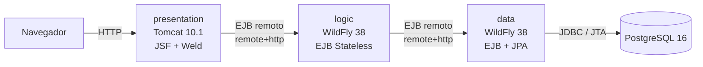

Estilo **N capas (llamada y retorno) distribuido**: cada capa llama solo a la inferior. La Lógica del T2 no cambia
sus reglas: su puerto `ResourceRequestRepository` ahora lo implementa un **adaptador remoto** que llama a la capa de
Datos (D-3).

### 3.2 Etapa ② — Capa de servicios

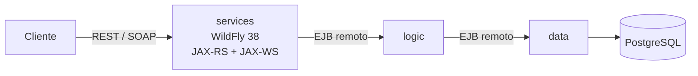

`services` es una **fachada sin reglas** (D-5): traduce protocolo ↔ contrato de Lógica y errores de negocio ↔
errores del protocolo. La Lógica sigue sin saber de HTTP ni de XML.

### 3.3 Etapa ③ — Varios clientes y API Gateway

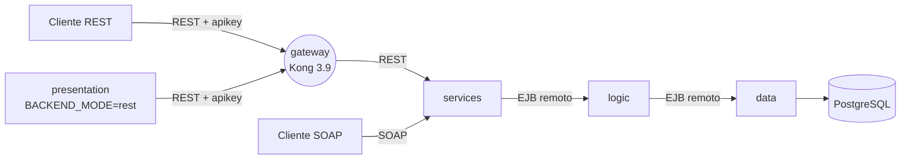

El gateway aplica **autenticación por API key**, **límite de demanda** y **correlation-id** sin código (D-6). SOAP entra
directo, como en el tablero (D-7). La misma aplicación JSF, cambiando una variable de entorno, deja de usar EJB y pasa
a consumir los servicios por el gateway (D-8, QA-MOD-1).

### 3.4 Comparación

| Criterio | ① N capas (EJB) | ② Servicios | ③ Servicios + gateway |
|---|---|---|---|
| Acoplamiento cliente → backend | Alto: contrato Java y cliente EJB de WildFly en el cliente | Bajo: HTTP + JSON o SOAP + WSDL | Bajo, y el cliente REST solo conoce la URL del gateway |
| Saltos de red en RF-2 | 2 (Tomcat → logic → data) | 3 (cliente → services → logic → data) | 4 por REST (cliente → gateway → services → logic → data); 3 por SOAP |
| Interoperabilidad | Solo clientes Java con el cliente EJB | Cualquier cliente HTTP o SOAP | Ídem, con un único punto de entrada REST |
| Seguridad | Usuario de aplicación de WildFly en cada salto EJB | Igual; los servicios quedan expuestos sin control propio | API key y límite de demanda en el gateway; SOAP sin esos controles (R-1) |
| Manejo de fallos | Timeout de invocación EJB (D-14) | Ídem + traducción a 5xx/Fault | Ídem + 429 ante picos |
| Complejidad operativa | 3 servidores + BD | 4 servidores + BD | 5 contenedores + BD; un componente más que operar |
| Latencia RF-2 (p50/p95) | Ver §12 (QA-REN-1) | Ver §12 | Ver §12 |

---

## 4. Vista lógica

### 4.1 Contratos compartidos y capas de negocio y datos

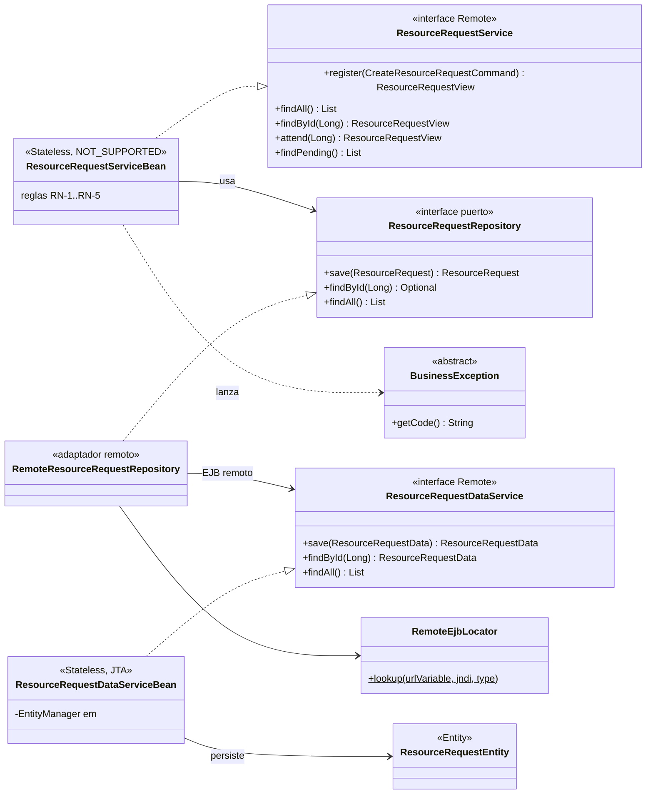

| Elemento | Módulo | Responsabilidad |
|---|---|---|
| `ResourceRequestService` | `contracts` | Contrato remoto de la Lógica (mismas operaciones del T2) |
| `ResourceRequestDataService` | `contracts` | Contrato remoto de Datos; `findById` devuelve `null` si no existe (`Optional` no es serializable) |
| DTO `CreateResourceRequestCommand`, `ResourceRequestView`, `ResourceRequestData`, enums | `contracts` | Datos que cruzan fronteras remotas; JavaBeans serializables (D-13) |
| `BusinessException` y sus tres hijas | `contracts` | Errores de negocio con `code` estable; `@ApplicationException` para llegar intactas al cliente remoto |
| `RemoteEjbLocator`, `JndiNames` | `contracts` | Política única de conexión EJB remota: URL, credenciales y timeout de invocación (D-14) |
| `ResourceRequestServiceBean` | `logic` | Reglas RN-1..RN-5 (código del T2); `NOT_SUPPORTED` para no propagar transacciones (D-11) |
| `ResourceRequestRepository` | `logic` | Puerto del T2, definido por el negocio |
| `RemoteResourceRequestRepository` | `logic` | Adaptador del puerto: traduce dominio ↔ `ResourceRequestData` y llama a Datos |
| `ResourceRequestDataServiceBean` | `data` | Persistencia con JPA; cada llamada es una transacción JTA local |
| `ResourceRequestEntity` | `data` | Mapeo de la tabla `resource_request` |

### 4.2 Estados de una solicitud

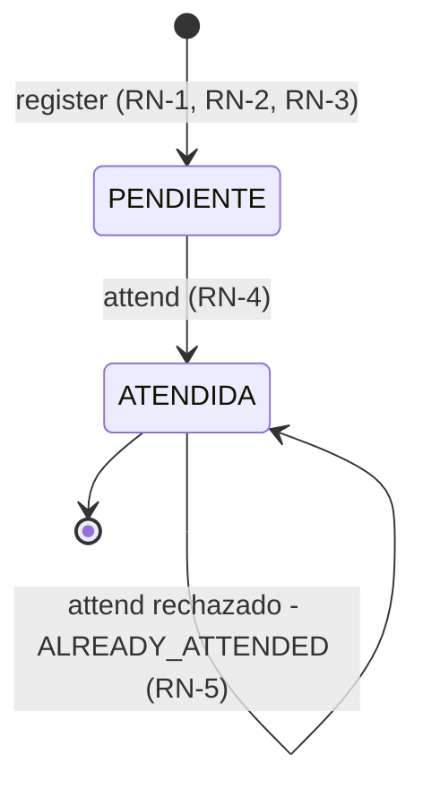

Solo la Lógica cambia el estado. Datos guarda el valor que recibe, sin validar transiciones.

### 4.3 Capa de servicios y presentación

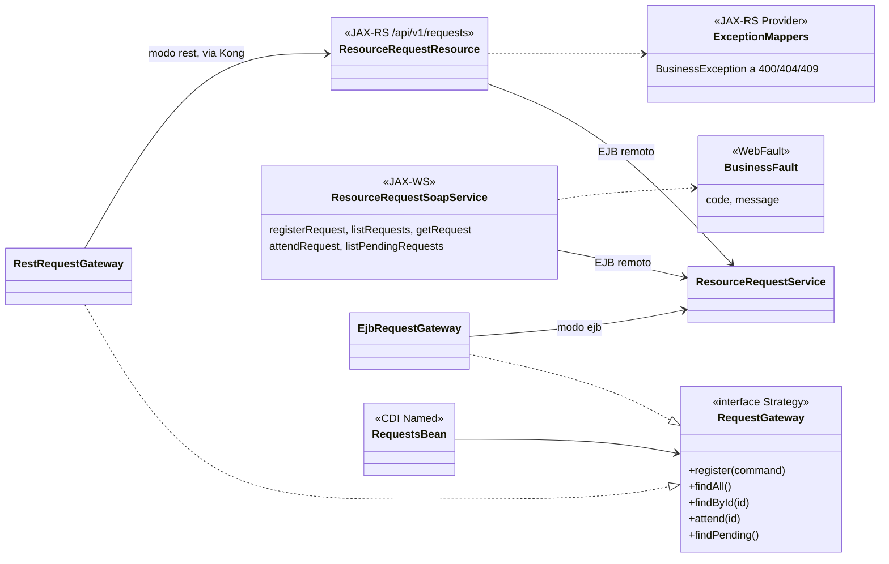

- **Fachada sin reglas.** `ResourceRequestResource` y `ResourceRequestSoapService` solo traducen: no validan cantidades
  ni estados. Los errores de negocio se traducen por `code`: REST a 400/404/409 con el cuerpo del T2
  `{code, message, timestamp}`, SOAP a un Fault con `<code>` y `<message>` en el `detail` (contrato en `docs/api.md`).
- **Strategy en la presentación (D-8).** Los beans JSF dependen de `RequestGateway`. Al arrancar se elige
  `EjbRequestGateway` o `RestRequestGateway` según `BACKEND_MODE`; las páginas no cambian.

---

## 5. Vista de desarrollo

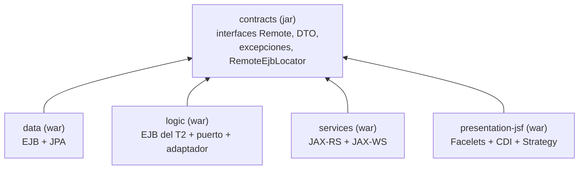

| Módulo | Artefacto | Servidor | Depende de |
|---|---|---|---|
| `contracts` | `contracts-*.jar` (dentro de cada WAR) | — | Jakarta EE API (solo compilación) |
| `data` | `data.war` | WildFly `data` | `contracts` |
| `logic` | `logic.war` | WildFly `logic` | `contracts` |
| `services` | `services.war` | WildFly `services` | `contracts` |
| `presentation-jsf` | `recursos.war` | Tomcat `presentation` | `contracts`, Jakarta Faces 4.0.28, Weld 5.1.7, cliente EJB de WildFly 38.0.1 |

**Por qué `logic` no depende de `data`.** Ningún módulo depende de otro módulo de capa: todos dependen solo de
`contracts` (D-4). La Lógica conoce a Datos únicamente por la interfaz `ResourceRequestDataService` y su nombre JNDI.
Se puede cambiar la implementación de Datos (otra base, otro servidor, otro mecanismo) sin recompilar la Lógica,
mientras se respete el contrato. Es la misma inversión de dependencias del T2, ahora entre procesos.

**Construcción.** Maven multi-módulo (Java 17). Cada imagen se construye con un Dockerfile **multi-etapa**: la etapa 1
compila el módulo y `contracts` con Maven dentro de Docker; la etapa 2 copia el WAR al servidor. Un clon limpio no
necesita Java ni Maven instalados (CON-4).

```text
JEE-Presentacion/
├── contracts/  data/  logic/  services/  presentation-jsf/
├── infra/wildfly/Dockerfile        imagen de data, logic y services (argumento MODULE)
├── infra/wildfly/{common,data,…}   scripts CLI aplicados al construir la imagen
├── infra/tomcat/Dockerfile         imagen de presentation
├── infra/kong/kong.yml             configuración declarativa del gateway
├── infra/postgres/init/            esquema SQL
├── docker-compose.yml
├── tests/postman/                  colecciones y entornos de Newman
├── scripts/                        escenarios de calidad y medición de latencia
└── docs/                           arquitectura, API, evidencias
```

---

## 6. Vista de procesos

### 6.1 Registrar desde JSF en la etapa ①

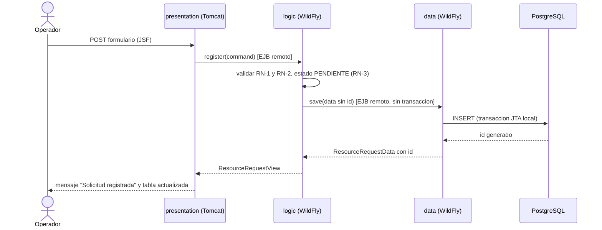

### 6.2 Atender vía REST y gateway en la etapa ③

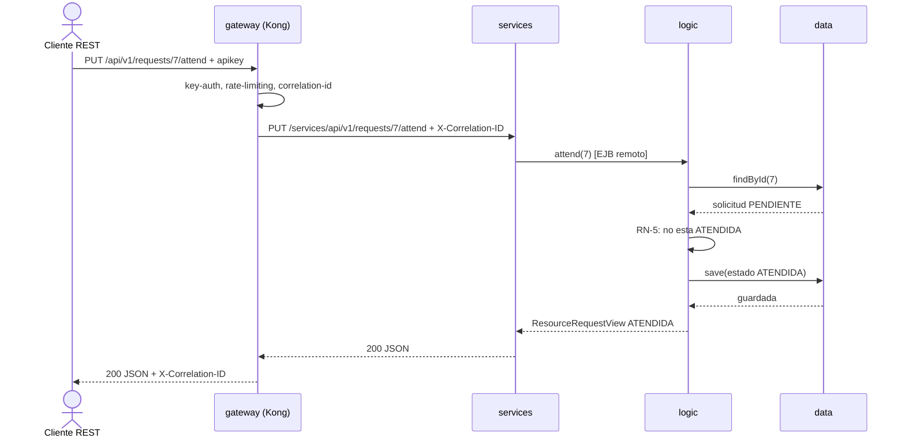

`findById` y `save` son dos transacciones locales de Datos (D-11). La ventana entre ambas es un riesgo conocido (R-5).

### 6.3 Consultar vía SOAP en la etapa ③

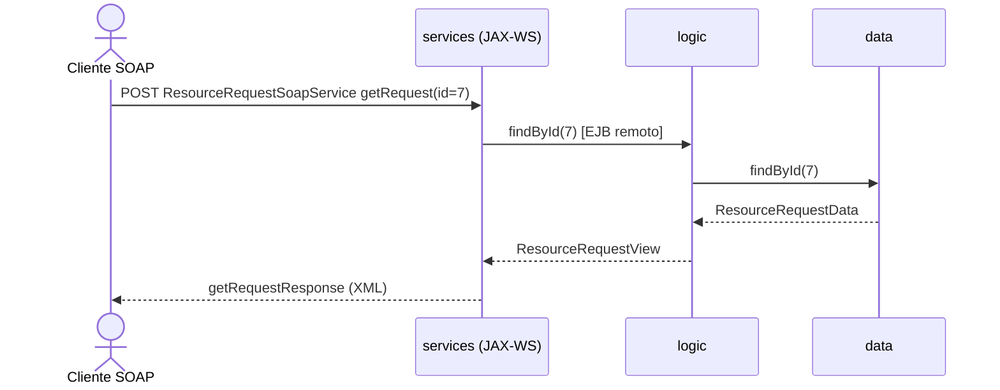

### 6.4 Error de regla de negocio propagado a los tres clientes

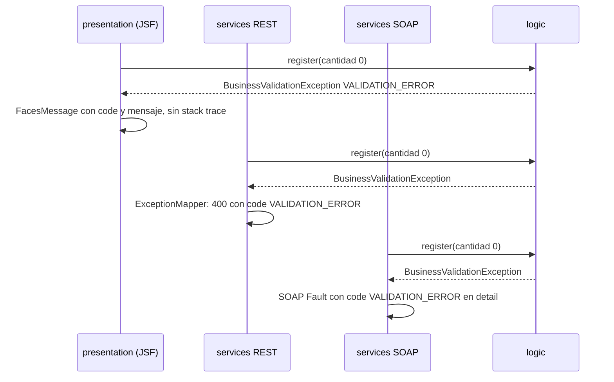

La excepción viaja **intacta** por EJB remoto (clase, `code` y mensaje) gracias a `@ApplicationException` y a que es
`Serializable`. Así lo comprobó el spike S-2. Cada cliente la presenta en su protocolo; la regla y el mensaje son uno solo.

---

## 7. Vista física / despliegue

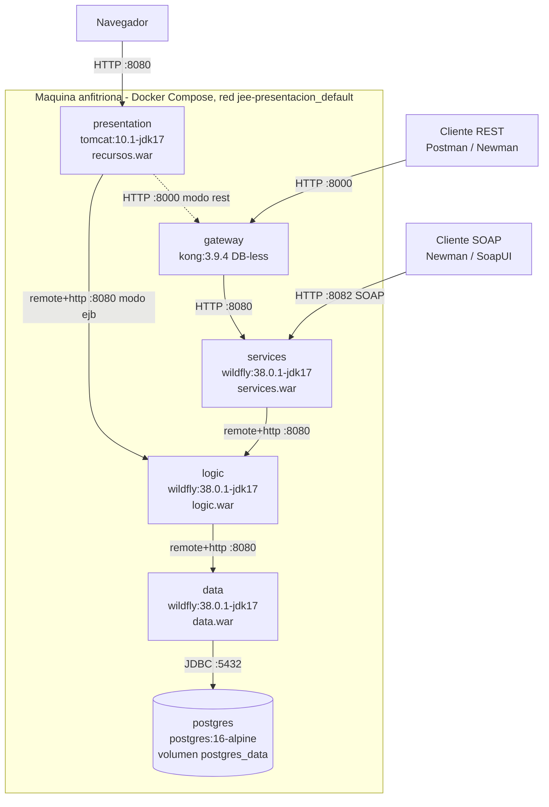

| Contenedor | Imagen | Puerto en el host | Protocolos de entrada | Expuesto |
|---|---|---|---|---|
| `presentation` | `tomcat:10.1-jdk17-temurin` + `recursos.war` | 8080 | HTTP (JSF) | Sí |
| `gateway` | `kong:3.9.4` | 8000 (admin 8001 solo interno) | HTTP REST | Sí |
| `services` | `wildfly:38.0.1.Final-jdk17` + `services.war` | 8082 | HTTP REST y SOAP | Sí (SOAP lo requiere; REST directo queda para pruebas, R-1) |
| `logic` | ídem + `logic.war` | — | EJB `remote+http` | No |
| `data` | ídem + `data.war` | — | EJB `remote+http` | No |
| `postgres` | `postgres:16-alpine` | 5434 | JDBC | Sí, solo para inspección local |

- **Arranque ordenado:** `postgres` → `data` → `logic` → `services` → `gateway` → `presentation`, con `depends_on` y
  healthchecks (`pg_isready`; marcador `<war>.deployed` de WildFly; `kong health`; HTTP 200 en `/recursos/`).
- **Seguridad entre capas:** cada salto EJB se autentica con el usuario de aplicación de WildFly
  (`EJB_USER`/`EJB_PASSWORD`, ApplicationRealm). El usuario se crea al arrancar el contenedor (`entrypoint.sh`), así que
  la contraseña no queda en la imagen.
- **Configuración por entorno:** URLs (`DATA_URL`, `LOGIC_URL`, `GATEWAY_URL`), credenciales, `BACKEND_MODE`,
  `EJB_INVOCATION_TIMEOUT_MS`, `TX_NODE_ID`; la tabla completa está en `docs/api.md`.
- **Un nodo por capa:** no hay réplicas. Es suficiente para el taller, pero cada capa es un punto único de falla (R-4).

---

## 8. Escenarios (+1)

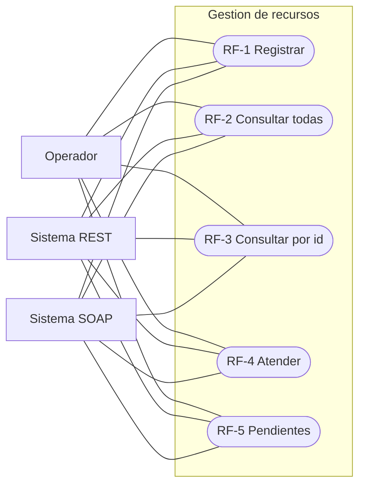

| Escenario | Lógica (§4) | Desarrollo (§5) | Procesos (§6) | Física (§7) | Evidencia |
|---|---|---|---|---|---|
| RF-1 registrar válida | `register` + RN-1..RN-3 en `ResourceRequestServiceBean` | `logic`, `data` | 6.1 | presentation → logic → data → postgres | Newman REST/SOAP; captura JSF |
| RF-1 cantidad 0 | `BusinessValidationException` | `contracts.exception` | 6.4 | Igual en los tres clientes | Newman (400 / Fault); captura JSF |
| RF-2 consultar todas | `findAll` | `data` (orden por id) | 6.1 (análogo) | Tres caminos medidos en QA-REN-1 | `scripts/medir-latencia.sh` |
| RF-3 por id / inexistente | `findById`; `null` → `RequestNotFoundException` | adaptador remoto | 6.3 | services → logic → data | Newman |
| RF-4 atender / dos veces | `attend` + RN-4, RN-5 | `logic` | 6.2 | gateway → services → logic → data | Newman (200 / 409) |
| RF-5 pendientes | `findPending` (filtro en Lógica, no en Datos) | `logic` | 6.1 (análogo) | Todos los clientes | Newman |

---

## 9. Decisiones arquitectónicas y tácticas

Cada decisión sigue la cadena **driver → alternativas → trade-off → decisión → evidencia**.

| ID | Decisión | Driver | Alternativas | Trade-off | Evidencia |
|---|---|---|---|---|---|
| D-1 | Estilo **N capas distribuido** (①) que evoluciona a **capa de servicios** (②③) | CON-1, CON-2, QA-INT-1 | Monolito en capas en un solo WAR | Gana despliegue y aislamiento por capa e interoperabilidad; pierde latencia (saltos de red) y suma complejidad operativa | §3; QA-REN-1 |
| D-2 | **EJB remoto** (`remote+http`) entre Presentación↔Lógica y Lógica↔Datos | CON-1, CON-3 | REST interno; RMI-IIOP | Contrato tipado, excepciones de negocio intactas, sin escribir serialización; acopla los clientes a Java/WildFly (lo resuelve ③) | Spikes S-1 y S-2 |
| D-3 | **Puerto/adaptador del T2** para distribuir Datos: `RemoteResourceRequestRepository` implementa el puerto | QA-MOD-1, CON-3 | Que la Lógica llame directo al EJB de Datos | Reglas del T2 intactas; el adaptador agrega una traducción dominio ↔ DTO | `git diff` del EJB T2 → T4 (solo paquetes, anotaciones y getters) |
| D-4 | Módulo **`contracts`** compartido | D-2 | Copiar las clases en cada módulo | Un solo contrato; un cambio obliga a recompilar todos los clientes (aceptable: los construye un solo build) | Vista de desarrollo |
| D-5 | **Fachada de servicios sin reglas** con REST y SOAP | QA-INT-1 | Exponer REST desde la Lógica | La Lógica sigue agnóstica de protocolo; un salto más | §3.4; QA-REN-1 |
| D-6 | **Kong 3.9 DB-less** como gateway REST, con `key-auth`, `rate-limiting` y `correlation-id` | QA-SEG-1, QA-DIS-2 | NGINX; Spring Cloud Gateway; sin gateway | Controles por configuración (un archivo), sin código; un componente más y un punto único de falla (R-4) | QA-SEG-1, QA-DIS-2 |
| D-7 | **SOAP directo** a `services` | Tablero ③ | SOAP por el gateway | Fiel al tablero; SOAP queda sin API key ni límite (R-1) | — |
| D-8 | **Strategy** en JSF con `BACKEND_MODE=ejb\|rest` | QA-MOD-1 | Dos aplicaciones JSF | Una sola UI para dos etapas; la variante REST suma una dependencia de cliente HTTP | QA-MOD-1 |
| D-9 | **WildFly 38.0.1** | S-6 | Payara 6 (usado en T2) | Cliente EJB remoto documentado y probado desde Tomcat; se pierde la familiaridad del T2 con Payara | Spikes |
| D-10 | Seguridad mínima: **usuario de aplicación** WildFly en cada salto EJB + **API key** en el gateway | QA-SEG-1 | Sin seguridad; OAuth2/JWT + TLS | Suficiente para demostrar el control; OAuth y TLS se difieren (sin un driver que los exija en el taller) | QA-SEG-1 |
| D-11 | Transacciones **JTA locales a Datos**; la Lógica es `NOT_SUPPORTED` | Integridad, simplicidad | Propagar la transacción (XA entre servidores) | Sin coordinador distribuido ni 2PC por red; `attend` queda en dos transacciones (R-5) | Spike S-2: con `REQUIRED` la transacción se propaga, con `NOT_SUPPORTED` no |
| D-12 | **Docker Compose**, sin Kubernetes | S-5, CON-4 | Kubernetes | Simple y reproducible; sin autoescalado ni autorrecuperación entre nodos | Arranque con `--wait` |
| D-13 | DTO como **JavaBeans** serializables (no `record`) | D-2, QA-INT-1 | Mantener los `record` del T2 | Funcionan en EL 5.0 de Tomcat 10.1 (JSF) y en JAXB (SOAP); más código repetitivo | Spike S-1: tabla JSF leyendo los DTO |
| D-14 | **Timeout de invocación EJB** (5 s) y una política de conexión común (`RemoteEjbLocator`) | QA-DIS-1 | Sin timeout; timeouts distintos en cada cliente | Fallas detectadas en ≤ 5 s; una operación legítima que tarde más de 5 s fallaría (punto de sensibilidad) | Medición: 135 s sin timeout, 10 s con 10 s |
| D-15 | Contenedores `logic` y `data` **sin puertos publicados** | Seguridad (limitar exposición) | Publicar todos los puertos | Superficie mínima; depurar requiere entrar a la red de Docker | `docker-compose.yml` |

### Tácticas por escenario

| Escenario | Tácticas (Bass) | Dónde |
|---|---|---|
| QA-MOD-1 | Encapsular; usar un intermediario; restringir dependencias; diferir el enlace (configuración en el despliegue) | `RequestGateway` + `BACKEND_MODE`; `contracts`; puerto/adaptador |
| QA-INT-1 | Adherirse a estándares (HTTP/JSON, SOAP/WSDL); adaptar la interfaz (tailor interface); usar un intermediario | `services` |
| QA-SEG-1 | Autenticar actores; limitar el acceso; limitar la exposición | Kong `key-auth`; usuario de aplicación EJB; `logic` y `data` sin puertos |
| QA-DIS-1 | Detección de excepciones; timeout; manejo de excepciones; reintroducción sin reinicio de las demás capas | `RemoteEjbLocator` (timeout); manejo en JSF/REST/SOAP; healthchecks |
| QA-DIS-2 | Gestionar las peticiones de trabajo / limitar la respuesta a eventos | Kong `rate-limiting` |
| QA-REN-1 | (Medición, no táctica): cuantifica el costo de usar un intermediario | `scripts/medir-latencia.sh` |
| Trazabilidad | Auditoría: correlación de peticiones | Kong `correlation-id` + log de acceso de `services` |

---

## 10. Riesgos, puntos de sensibilidad y trade-offs

| ID | Riesgo | Causa (decisión) | Consecuencia | Mitigación |
|---|---|---|---|---|
| R-1 | SOAP y REST directo sin API key ni límite de demanda | D-7; `services` publicado en 8082 | Un cliente puede saltarse los controles del gateway | En producción: publicar solo el gateway y enrutar SOAP por él (una ruta más en `kong.yml`), o WS-Security |
| R-2 | Latencia acumulada por saltos de red | D-1, D-5, D-6 | Cada capa suma red y serialización | Medida en QA-REN-1; aceptable para el dominio (operación humana) |
| R-3 | Clientes de ① acoplados a Java y WildFly | D-2 | La UI no puede cambiar de plataforma sin cambiar de protocolo | Es exactamente lo que ③ resuelve (`BACKEND_MODE=rest`) |
| R-4 | Puntos únicos de falla: gateway y cada capa con un solo nodo | D-6, D-12 | La caída de un contenedor deja sin servicio a sus clientes | Detección rápida (D-14) y recuperación automática al volver; réplicas detrás de un balanceador si se exigiera disponibilidad |
| R-5 | Dos atenciones simultáneas de la misma solicitud podrían pasar RN-5 | D-11: `findById` y `save` en transacciones distintas | Doble atención en una carrera estrecha | Bloqueo optimista (`@Version`) en Datos, o una operación atómica "atender si está PENDIENTE" en el contrato de Datos |
| R-6 | Credenciales y API key por defecto en `docker-compose.yml` | Comodidad del taller | Si se despliega tal cual, cualquiera conoce las claves | Se pueden sobrescribir con variables de entorno o un `.env` no versionado |

**Puntos de sensibilidad**
- `EJB_INVOCATION_TIMEOUT_MS` (D-14): más bajo mejora la detección de fallas (QA-DIS-1), pero aumenta los falsos
  negativos ante lentitud transitoria de una capa sana.
- Límite de `rate-limiting` (D-6): más bajo protege mejor a `services` (QA-DIS-2), pero rechaza tráfico legítimo en picos.
- `NOT_SUPPORTED` en la Lógica (D-11): define si existe o no una transacción distribuida.

**Trade-offs principales**
- **Distribuir (D-1/D-2) vs rendimiento:** aislamiento y despliegue por capa a cambio de latencia (QA-REN-1).
- **Gateway (D-6) vs disponibilidad y latencia:** seguridad y control de demanda a cambio de un salto y un punto único de falla.
- **Interoperabilidad (D-5, D-13) vs simplicidad:** clientes no Java a cambio de una capa de traducción y DTO más verbosos.

---

## 11. Trazabilidad

| Driver | Escenario | Decisiones | Elementos | Vista | Evidencia |
|---|---|---|---|---|---|
| CON-1, QA-MOD-1 | QA-MOD-1 | D-3, D-4, D-8 | `RequestGateway`, puerto/adaptador, `contracts` | Lógica, desarrollo | `scripts/qa-mod-1.sh` + `git diff` |
| CON-2 | QA-INT-1 | D-5, D-13 | `services` (JAX-RS, JAX-WS) | Lógica, procesos 6.2–6.4 | Newman REST y SOAP |
| CON-2 | QA-SEG-1 | D-6, D-10, D-15 | `gateway` (`key-auth`) | Física | `scripts/qa-seg-1.sh` |
| Operación continua | QA-DIS-1 | D-14, D-11 | `RemoteEjbLocator`, healthchecks | Procesos, física | `scripts/qa-dis-1.sh`; `docs/evidencias/spikes.md` |
| Picos de demanda | QA-DIS-2 | D-6 | `gateway` (`rate-limiting`) | Física | `scripts/qa-dis-2.sh` |
| Costo de distribuir | QA-REN-1 | D-1, D-5, D-6 | Los tres caminos | §3.4 | `scripts/medir-latencia.sh` |
| RN-1..RN-5 | Error de negocio igual en los tres clientes | D-2, D-4, D-5 | `BusinessException` + traductores | Procesos 6.4 | Newman + captura JSF |

---

## 12. Resultados de pruebas

Las cifras de esta sección son las que imprimieron las pruebas y los scripts; lo que aún no se ha ejecutado se marca
como pendiente. Las salidas completas están en `docs/evidencias/`.

| Prueba | Fecha | Resultado |
|---|---|---|
| Spike S-1: Tomcat (JSF + Weld) → `logic` por EJB remoto | 2026-10-28 | Cumple: RF-1..RF-5 y error de negocio en `h:messages` |
| Spike S-2: `logic` → `data` por EJB remoto; DTO y excepciones | 2026-10-28 | Cumple; `REQUIRED` propaga la transacción y `NOT_SUPPORTED` no (D-11) |
| Capa de Datos real (JPA + PostgreSQL) con la cadena del spike | 2026-10-28 | Cumple: RF-1..RF-5, tres errores de negocio y filas persistidas |
| Timeout EJB ante caída de `data` (antecedente de QA-DIS-1) | 2026-10-28 | Sin timeout: 135 s; con `invocation.timeout=10000`: 10 s; recuperación sin reiniciar otras capas |
| Pruebas unitarias `contracts` y `data` | 2026-10-28 | 14/14 en verde |
| QA-SEG-1 (gateway, `services` aún sin REST) | 2026-10-28 | Cumple: 401 sin clave y con clave inválida; 0 peticiones rechazadas en el log de `services`; Newman 7/7 |
| QA-DIS-2 (gateway, `services` aún sin REST) | 2026-10-28 | Cumple: ráfaga de 50 → 27 atendidas, 23 rechazadas con 429; `services` siguió respondiendo |
| Newman REST y SOAP (QA-INT-1) | — | Pendiente: requiere `services` |
| QA-MOD-1, QA-DIS-1, QA-REN-1 de punta a punta | — | Pendiente: requieren `logic`, `services` y `presentation` |
| Pruebas unitarias `logic` y `services` | — | Pendiente |
